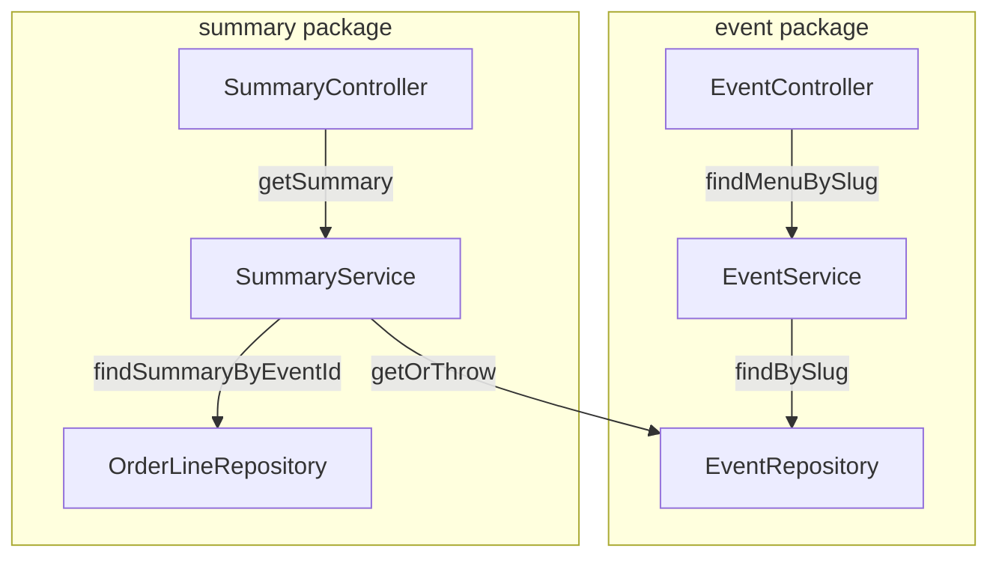

# Design Document

## Overview

This feature adds two read-only endpoints to the existing `kassa-app-api` Spring Boot POS application.

1. **Menu endpoint** — `GET /api/events/slug/{slug}/menu` returns the full product menu for an event (categories and products), resolved by slug rather than UUID. This allows the frontend to render the POS screen in a single request.

2. **Sales summary endpoint** — `GET /api/events/{id}/summary` returns per-product and per-category aggregations (units sold and revenue) derived from all confirmed orders for that event.

Both endpoints are read-only and fit naturally into the existing layered architecture. No new persistence or domain model changes are required — the data already exists; only new query, service, and controller logic is needed.

## Architecture

The design follows the same package-per-domain, three-layer convention used throughout the codebase:

```
Controller  →  Service  →  Repository
(HTTP/DTO)     (logic)      (JPA/JPQL)
```

### Menu endpoint placement

The menu endpoint shares the slug-based path prefix `/api/events/slug/{slug}` that already exists on `EventController`. Adding it as a new `@GetMapping("/slug/{slug}/menu")` method on the existing `EventController` is the natural fit — it reuses the event-lookup plumbing and keeps all event-centric reads in one controller.

The actual menu assembly logic (loading categories and products with the correct sort order) lives in `EventService`.

### Sales summary placement

The summary is a separate read concern that joins orders, order lines, products, and categories. It has no behaviour overlap with `EventService` or `OrderService`, so it gets its own thin service class: `SummaryService`. Its controller, `SummaryController`, maps to `/api/events/{id}/summary`.

**Rationale for a separate `SummaryService`**: keeping aggregation logic out of `EventService` maintains the single-responsibility principle and avoids adding an `OrderRepository` dependency to the event layer.

### Component diagram



## Components and Interfaces

### Menu endpoint

**`EventController`** — new method added to the existing controller:
```java
@GetMapping("/slug/{slug}/menu")
public MenuResponse getMenu(@PathVariable String slug)
```
Delegates to `EventService.findMenuBySlug(slug)`. Returns `MenuResponse` directly (200 OK). `EntityNotFoundException` is already handled globally by `ApiExceptionHandler` → 404.

**`EventService`** — new method:
```java
public MenuResponse findMenuBySlug(String slug)
```
Loads the `Event` via `EventRepository.findBySlug(slug)` (throws `EntityNotFoundException` on miss), then maps it to `MenuResponse`. The `@OrderBy("sortOrder ASC")` JPA annotation on `Event.categories` handles primary sort; a secondary tie-break by `id` is applied in Java using `Comparator.comparingInt(Category::getSortOrder).thenComparing(Category::getId)`. Same comparator pattern for products within each category.

### Sales summary endpoint

**`SummaryController`** — new controller in package `be.sennegeerts.kassa_app_api.summary`:
```java
@RestController
@RequestMapping("/api/events/{id}/summary")
public class SummaryController
```
Single method:
```java
@GetMapping
public EventSummaryResponse getSummary(@PathVariable UUID id)
```
Delegates to `SummaryService.getSummary(id)`.

**`SummaryService`** — new service in the same package:
```java
@Service
@Transactional(readOnly = true)
public class SummaryService
```
Dependencies: `EventRepository` (for existence check) and `OrderLineRepository` (for aggregation query).

Method:
```java
public EventSummaryResponse getSummary(UUID eventId)
```
1. Verifies the event exists via `EventRepository.findById(eventId)` (throws `EntityNotFoundException` on miss).
2. Queries `OrderLineRepository` for all order lines belonging to the event.
3. Performs in-memory aggregation using Java streams grouped by `product` → then by `category`.
4. Returns `EventSummaryResponse`.

**`OrderLineRepository`** — new method added to the existing repository:
```java
@Query("SELECT ol FROM OrderLine ol JOIN FETCH ol.product p JOIN FETCH p.category c WHERE ol.order.event.id = :eventId")
List<OrderLine> findByEventId(@Param("eventId") UUID eventId);
```
The `JOIN FETCH` prevents N+1 queries when navigating `product` and `category`.

### Query strategy decision

**In-memory aggregation (chosen)** over a JPQL `GROUP BY` aggregate query for the following reasons:

- The domain model already loads `OrderLine` with `unitPrice` and `nameSnapshot` as snapshots — aggregation is a simple stream fold, no SQL arithmetic needed.
- JPQL aggregation queries return `Object[]` or projections, which add complexity with no measurable performance benefit for the expected data volumes of a POS event.
- In-memory grouping keeps the service layer purely in Java and makes it straightforward to test without a database.
- A single `JOIN FETCH` query avoids N+1 and brings the data in one round-trip.

If event sizes grow to tens of thousands of orders in the future, switching to a JPQL `GROUP BY` query is a contained refactor inside `SummaryService`.

## Data Models

No new JPA entities are required. All new types are DTOs (Java records).

### Menu DTOs — package `be.sennegeerts.kassa_app_api.event.dto`

```java
public record MenuResponse(
    UUID id,
    String name,
    String slug,
    List<MenuCategoryItem> categories
) {
    public static MenuResponse from(Event event) { ... }
}

public record MenuCategoryItem(
    UUID id,
    String name,
    int sortOrder,
    List<MenuProductItem> products
) {
    public static MenuCategoryItem from(Category category) { ... }
}

public record MenuProductItem(
    UUID id,
    String name,
    BigDecimal price,
    int sortOrder
) {
    public static MenuProductItem from(Product product) { ... }
}
```

The `MenuResponse.from(Event)` factory applies the tie-breaking comparator before mapping:
```java
event.getCategories().stream()
    .sorted(Comparator.comparingInt(Category::getSortOrder)
                      .thenComparing(Category::getId))
    .map(MenuCategoryItem::from)
    .toList()
```
`MenuCategoryItem.from(Category)` applies the equivalent comparator to products.

### Summary DTOs — package `be.sennegeerts.kassa_app_api.summary`

```java
public record ProductSummary(
    UUID productId,
    String nameSnapshot,
    int quantitySold,
    BigDecimal revenue          // rounded to 2 decimal places
) {}

public record CategorySummary(
    UUID categoryId,
    String categoryName,
    int totalQuantitySold,
    BigDecimal totalRevenue,    // rounded to 2 decimal places
    List<ProductSummary> products
) {}

public record EventSummaryResponse(
    List<CategorySummary> categories
) {}
```

`SummaryService` builds these from the flat `List<OrderLine>` returned by the repository query:

```
OrderLine list
  → group by product (UUID key, using nameSnapshot from OrderLine)
  → for each group: sum quantity, sum unitPrice×quantity → ProductSummary
  → group ProductSummary entries by category (category id from product.getCategory())
  → for each category group: sum quantitySold, sum revenue → CategorySummary
  → wrap in EventSummaryResponse
```

Revenue rounding uses `BigDecimal.setScale(2, RoundingMode.HALF_UP)`.

### No status field on `Order`

`Order` has no status column — every persisted order is an implicitly completed sale. The `findByEventId` query therefore includes all order lines with no status filter.

## Correctness Properties

*A property is a characteristic or behavior that should hold true across all valid executions of a system — essentially, a formal statement about what the system should do. Properties serve as the bridge between human-readable specifications and machine-verifiable correctness guarantees.*

### Property 1: Menu response contains all event fields

*For any* `Event` with any combination of categories and products, mapping it to a `MenuResponse` via `MenuResponse.from(event)` must produce a response whose `id`, `name`, and `slug` equal the event's corresponding fields, and whose `categories` list has the same size as the event's category list.

**Validates: Requirements 1.1**

### Property 2: Categories and products are sorted by sortOrder then id

*For any* `Event` with any list of `Category` objects (including ties in `sortOrder`), and for any `Category` with any list of `Product` objects (including ties in `sortOrder`), the `MenuResponse` produced by `MenuResponse.from(event)` must have its category list sorted by `sortOrder` ascending with ties broken by `id` ascending, and each category's product list sorted by the same comparator.

**Validates: Requirements 1.2, 1.3**

### Property 3: Product-level aggregation is correct

*For any* non-empty list of `OrderLine` objects for a single product (with arbitrary quantities and unit prices), the `ProductSummary` computed by `SummaryService` must have `quantitySold` equal to the sum of all line quantities, and `revenue` equal to the sum of `unitPrice × quantity` across all lines, rounded to two decimal places.

**Validates: Requirements 2.2**

### Property 4: Category aggregation equals sum of its product summaries

*For any* list of `ProductSummary` entries grouped by category, the resulting `CategorySummary` must have `totalQuantitySold` equal to the sum of all product `quantitySold` values and `totalRevenue` equal to the sum of all product `revenue` values for that category.

**Validates: Requirements 2.3**

### Property 5: Summary and menu response DTOs contain all required fields

*For any* `ProductSummary` instance with arbitrary field values, and *for any* `CategorySummary` wrapping it, the serialized JSON response must include `productId`, `nameSnapshot`, `quantitySold`, and `revenue` at the product level, and `categoryId`, `categoryName`, `totalQuantitySold`, `totalRevenue`, and `products` at the category level; all monetary values must be serialized with exactly two decimal places.

**Validates: Requirements 2.4, 2.5**

## Error Handling

Both endpoints reuse the existing `ApiExceptionHandler` (`@RestControllerAdvice`) for error responses.

| Scenario | Exception thrown | HTTP response |
|---|---|---|
| Slug not found (menu) | `EntityNotFoundException` | 404 with RFC 9457 ProblemDetail |
| Event id not found (summary) | `EntityNotFoundException` | 404 with RFC 9457 ProblemDetail |

No new exception types or handler methods are needed.

## Testing Strategy

### Unit tests

Unit tests target the pure mapping and aggregation logic, with no Spring context or database required.

- **`MenuResponseTest`** — verifies `MenuResponse.from(Event)` produces the correct structure for events with multiple categories and products, including the tie-breaking sort order.
- **`SummaryServiceTest`** — verifies product-level and category-level aggregation on a hand-crafted list of `OrderLine` objects, including the empty-orders edge case and revenue rounding.

### Property-based tests

Use **jqwik** (Java property-based testing library, compatible with JUnit 5 and Spring Boot test).

Add to `pom.xml`:
```xml
<dependency>
    <groupId>net.jqwik</groupId>
    <artifactId>jqwik</artifactId>
    <version>1.9.3</version>
    <scope>test</scope>
</dependency>
```

Each property test runs a minimum of **100 iterations**.

- **`MenuResponsePropertyTest`**
  - **Feature: menu-and-sales-summary, Property 1: Menu response contains all event fields**
    Generates random `Event` objects (arbitrary name, slug, and 0–10 categories each with 0–5 products). Verifies `id`, `name`, `slug` match and category count matches.
  - **Feature: menu-and-sales-summary, Property 2: Categories and products are sorted by sortOrder then id**
    Generates events where categories and products have arbitrary (possibly duplicate) `sortOrder` values. Verifies the output lists satisfy the ordering invariant.

- **`SummaryServicePropertyTest`**
  - **Feature: menu-and-sales-summary, Property 3: Product-level aggregation is correct**
    Generates lists of (quantity, unitPrice) pairs for a single product. Computes expected sum in the test and compares with the service result.
  - **Feature: menu-and-sales-summary, Property 4: Category aggregation equals sum of its product summaries**
    Generates lists of `ProductSummary` objects grouped by category id. Verifies `CategorySummary` totals are consistent with the products.
  - **Feature: menu-and-sales-summary, Property 5: Summary and menu response DTOs contain all required fields**
    Generates arbitrary `ProductSummary` and `CategorySummary` instances. Verifies all required fields are non-null and monetary values have scale 2.

### Integration tests

Spring Boot `@SpringBootTest` slice tests (`@WebMvcTest` or `@DataJpaTest`) covering:

- Menu endpoint returns 200 with correct body for a seeded event.
- Menu endpoint returns 404 for an unknown slug.
- Summary endpoint returns 200 with correct aggregation for a seeded event with orders.
- Summary endpoint returns 200 with an empty category list for an event with no orders.
- Summary endpoint returns 404 for an unknown event id.
